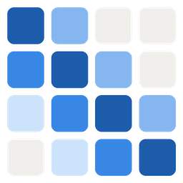

<p align="center">
  
</p>

# Commute Rain

How much rain would I ride through, per departure time?

Commute Rain takes the GPX track of a bike commute and lays the German
weather service's (DWD) rain radar over it, segment by segment and minute by
minute. For every possible departure time it works out how much rain you
would ride through, and which departure keeps you driest. The data comes from
[Bright Sky](https://brightsky.dev/), a free API with no key.

It answers two questions:

- **Next 2 hours (radar nowcast):** a 5-minute, 1 km radar forecast. Each
  segment of the route is looked up at the time you would actually reach it.
- **Next 2 days (hourly forecast):** expected rain and rain probability for
  your commute windows, e.g. 07:00–09:30 and 15:00–18:00.

It comes as a **Home Assistant integration** (sensors, a heatmap image, a
notification blueprint) and as a plain **Python package** with a Jupyter
notebook.


*Example with a synthetic rain front on the Cologne sample routes. Each
column is one departure time; each cell is the rain you would meet on that
part of the route. The bars below show the total per ride. The dashed line
marks the best departure. Hatched cells lie beyond the end of the radar
nowcast (no data, not dry).*

## Home Assistant integration

Needs Home Assistant 2025.3 or newer (for config subentries).

### Install

1. Copy `custom_components/commute_rain/` into your Home Assistant
   `config/custom_components/` and restart. Home Assistant installs
   `matplotlib` on first start.
2. Optional: copy `blueprints/automation/commute_rain/` into
   `config/blueprints/automation/` for the notification blueprint.

### Set up

1. *Settings → Devices & services → Add integration → Commute Rain*. This
   creates the shared backend; there is only one.
2. On that entry, choose **Add commute**: a name and how to split the route
   (by km or by riding minutes). Then set up the **outbound** and **return**
   legs. Each leg has:
   - a GPX upload. Timestamps in the track give the speed profile; without
     them, set a ride duration. The return leg can reuse the outbound track
     reversed.
   - a **forecast window** (fixed, e.g. 15:00–18:00) for the 48 h forecast.
   - a **radar window** for the 2 h nowcast: optional start (empty = from
     now), end, and an optional look-ahead in minutes (rolling window).
3. Add as many commutes as you like. Each commute becomes a device.
4. Hub options: rain limit (default 0.3 mm/h), poll the radar all day, demo
   mode.

Tracks are stored in the config entry, resampled to one point every 50 m
(about 20 points per km). The uploaded GPX file itself is not kept.

### Entities

Each commute has these entities for each leg (`outbound` and `return`):

| entity | meaning |
|---|---|
| `sensor.<commute>_rain_if_leaving_now_<leg>` | mm on the ride if you leave now (radar). Attribute `departures`: every candidate departure with total and peak, for custom charts |
| `sensor.<commute>_best_departure_<leg>` | time of the departure with the least rain in the radar window that stays within the rain limit; unknown if there is none |
| `sensor.<commute>_rain_at_best_departure_<leg>` | mm at that departure |
| `binary_sensor.<commute>_ride_within_rain_limit_<leg>` | on if such a departure exists |
| `sensor.<commute>_forecast_rain_next_window_<leg>` | expected mm at the best departure in the next forecast window (least rain if none stays within the limit). Attributes: day, min/max mm, probability, rides |
| `sensor.<commute>_forecast_best_departure_<leg>` | time of that departure |
| `sensor.<commute>_forecast_rain_probability_<leg>` | highest hourly rain probability in that window |
| `image.<commute>_rain_heatmap_<leg>` | heatmap over the leg's departure window (today's while it is open, else tomorrow's), in a compact layout for phones. Radar where the nowcast reaches, the hourly forecast (dotted) beyond it. Rendered only when viewed, at most once per update |

Radar sensors are *unknown* while the radar is idle (see below).

### Notification blueprint

`blueprints/automation/commute_rain/commute_rain_notification.yaml` sends a
push notification at a time and on days you choose, e.g. "Leave at 07:45". It
includes the best departure, the rain if you leave now, the forecast for the
window, and the heatmap as an image (Companion app). Pick a time when the
radar is being polled: no earlier than 2 h before the window starts.

### Demo mode

Replaces the radar with a synthetic rain front and a shower that cross your
routes every 90 minutes, without radar requests. Useful on dry days. The
forecast stays live.

### API usage

All commutes share one backend:

- **Radar:** every 5 minutes, **one** request for the combined area of all
  legs. Commutes too far apart (combined area over 150 km per side) are split
  into a few requests. The radar is only polled from 2 h before a leg's radar
  window opens until it closes, unless "poll all day" is on. A rolling
  window without a start begins with the forecast window.
- **Forecast:** hourly. One request per commute centre, rounded to 0.05°, so
  nearby commutes share it.
- Manual refreshes within 5 minutes (radar) or 1 hour (forecast) reuse the
  last response.

## Python package and notebook

The integration's logic lives in the `commute_rain` package, which runs on
its own: no Home Assistant needed.

### Setup

```sh
uv venv --python 3.12
source .venv/bin/activate
uv pip install -e ".[dev]"
python -m ipykernel install --user --name commute-rain --display-name "commute-rain (.venv)"
nbstripout --install   # git filter: notebook outputs (route plots) are never committed
```

### Run

- **Notebook:** open `demo.ipynb` (kernel "commute-rain (.venv)"). It loads
  two routes, fetches the live radar, plots a synthetic rain front, and shows
  the 48 h forecast with the expected rain per commute window. Set
  `MODE = "replay"` to rerun from the last recorded response without network.
- **Your own routes:** `routes/to_work.gpx` and `routes/from_work.gpx` are
  made-up sample rides in Cologne (Köln Süd → Messe over the Severinsbrücke,
  back over the Hohenzollernbrücke), generated by
  `scripts/make_sample_routes.py`. Put your own tracks in `routes/` under any
  other name and point the config at them. Other GPX files there are
  gitignored, so your real routes are never committed.
- **In code:** results are plain dataclasses, no plotting needed:

  ```python
  from pathlib import Path
  from commute_rain.brightsky_client import BrightSkyClient
  from commute_rain.config import Config, RouteConfig
  from commute_rain.radar import best_departure, rain_if_leaving_now
  from commute_rain.update import fetch_radar, load_routes, radar_matrices

  cfg = Config(routes=(RouteConfig("To work", Path("routes/to_work.gpx")),))
  client = BrightSkyClient(cfg.cache_dir, cfg.user_agent)
  routes = load_routes(cfg)
  radar = fetch_radar(client, routes, cfg)
  for name, m in radar_matrices(routes, radar, cfg).items():
      print(name, rain_if_leaving_now(m, cfg.timezone), best_departure(m, cfg.timezone))
  ```

### Layout

| module | purpose |
|---|---|
| `config.py` | `Config` with a list of `RouteConfig` (GPX, segmenting, duration, reverse, commute windows) |
| `route.py` | GPX → segments (equal km or equal minutes), time offsets from GPX timestamps or constant speed, reverse |
| `radar.py` | lat/lon → radar pixel, response parsing, departure × segment matrix, "leave now" / "best departure" |
| `forecast.py` | hourly forecast parsing, expected rain per ride and per commute window |
| `brightsky_client.py` | HTTP client with an on-disk cache that is also the record/replay store |
| `synthetic.py` | moving rain bands for testing on dry days |
| `update.py` | one update cycle: fetch the radar once for all routes, compute per route |
| `plots.py` | heatmap with the total-rain strip, forecast timeline, route-on-radar map |

Everything in `route.py` (except `load_gpx`), `radar.py`, `forecast.py` and
`synthetic.py` is pure: data in, plain data out, no I/O.

## Development

- **Tests:** `pytest` runs the core tests. They replay the recorded API
  responses in `tests/data/` (Cologne, 2026-10-29) and need no network.
- **Home Assistant tests** need Python 3.13 and their own venv:
  ```sh
  uv venv .venv-ha --python 3.13
  uv pip install --python .venv-ha/bin/python pytest-homeassistant-custom-component matplotlib
  .venv-ha/bin/pytest tests_ha
  ```
- **Core copy:** Home Assistant can't install the local package, so the
  integration ships a copy in `custom_components/commute_rain/core/`. After
  changing `commute_rain/`, run `python scripts/sync_core.py`;
  `tests/test_core_sync.py` fails if you forget.
- **Scripts:** `build_notebook.py` regenerates `demo.ipynb`,
  `make_sample_routes.py` the sample GPX files, `make_icon.py` the logo.
  `routes/gpx_plotter.py` draws a GPX track as an interactive map with
  timestamps.

## How it works: what was verified about the API

Sources: the OpenAPI spec at `https://api.brightsky.dev/openapi.json` (the
docs page renders it), and live requests from 2026-10-24 on.

### `/radar` (nowcast)

- Parameters: `bbox` (top, left, bottom, right, **in pixels**, inclusive)
  or `lat`+`lon`+`distance` (metres); `date`, `last_date` (ISO 8601);
  `format` = `compressed` (default; base64 zlib of little-endian uint16) /
  `bytes` / `plain`; `tz`.
- `plain` and `bytes` are rejected with HTTP 400 unless the client sends
  `Accept-Encoding: gzip/br/zstd`. We use `compressed`.
- Without `date`, the API starts 1 h before the latest measurement and
  `last_date` defaults to `date + 2 h`, which would cut the nowcast short.
  So we request `now − 15 min … now + 3 h` explicitly.
- Values are 0.01 mm per 5 min → **mm/h = value × 0.12**. The smallest
  non-zero intensity is 0.12 mm/h.
- Each frame holds the rain of the 5 minutes ending at its timestamp. We look
  up the frame whose interval contains departure + segment midpoint offset.
- `source` is `RADARCOMP::RV::<time of measurement>`. When it equals the
  frame timestamp, the frame is an observation; later frames are nowcasts.
  The nowcast runs to the latest measurement + 2 h (25 frames including the
  observation).
- Past radar is kept for 6 h.
- Grid: 1200 rows × 1100 columns, 1 km, polar stereographic
  `+proj=stere +lat_0=90 +lat_ts=60 +lon_0=10 +a=6378137 +b=6356752.3142451802 +x_0=543196.83521776402 +y_0=3622588.8619310018`.
  Pixel (row, col) is centred at x = col·1000 m, y = −row·1000 m. Implemented
  in numpy (no pyproj). It reproduces the four documented grid corners (pixel
  edges, ±0.5 px) and the API's own `latlon_position` to 0.001 px (tests).

### `/weather` (hourly forecast)

- Parameters: `lat`, `lon`, `date`, `last_date` (default `date` + 1 day),
  `max_dist`, `tz`, `units`. Precipitation is always in mm.
- `precipitation` = total mm in the 60 minutes *before* `timestamp` (so also
  the mean mm/h of that hour). `precipitation_probability` = % chance of
  more than 0.1 mm in that hour (forecasts only).
  `precipitation_probability_6h` exists only at 00/06/12/18 UTC and is not used.
- The response can start with an observed hour from a "current" station.
  Only records whose source has `observation_type == "forecast"` are kept.
  For the Cologne sample routes the forecast comes from the MOSMIX station
  KOELN (BOTAN.GART.), about 4.5 km away.
- Expected rain for a ride = Σ over hours (mm/h × hours of the ride inside
  that hour). Probability = the highest probability among the hours the ride
  touches.

### Being polite to the API

Bright Sky is run by volunteers, so the client:

- sends a descriptive User-Agent;
- makes one radar request per update for the combined area of all routes
  (13 × 14 px for the sample routes);
- caches responses on disk and reuses the radar for 5 minutes and the
  forecast for 1 hour. The same files are the recording for replay. They are
  never deleted automatically; clean `data/cache/` by hand.

## Known limitations

- One radar pixel per segment (at its midpoint) and one frame per segment.
  1 km / 5 min segments match the radar resolution; longer segments smooth
  away small showers.
- The ride's speed profile comes from the GPX timestamps, including that
  ride's traffic-light stops.
- Nowcast skill drops quickly after 30–60 minutes; the last hour is a rough
  guide.
- "Best departure" = least total rain among rides fully inside the nowcast
  and inside the commute window, never above the rain limit (default
  0.3 mm/h) on any segment. Ties go to the earliest departure. If nothing
  qualifies, there is no best departure; the plot then shows the least-rain
  departure as a dotted line. The radar comes in 0.12 mm/h steps, so a
  0.3 mm/h limit in effect allows 0.12 and 0.24 mm/h.
- Radar sees rain aloft: drizzle can be missed and virga can show as rain.
- The forecast is a single point for the whole area, with no spatial
  detail. `forecast_points="route_points"` takes the maximum over the start,
  middle and end of each route; these are usually served by the same
  station, so expect little difference.
- Commute windows apply every day, including weekends (the notification
  blueprint has its own day selection).
- Radar coverage is Germany and its borders only (DWD).

## Data and licence

Weather data: [Deutscher Wetterdienst](https://www.dwd.de/) (DWD) open data,
retrieved through the free [Bright Sky](https://brightsky.dev/) API. DWD data
may be reused under [CC BY 4.0](https://creativecommons.org/licenses/by/4.0/)
with a source notice; Bright Sky passes the DWD's terms through. This project
resamples and combines the data (radar along the route, forecast per commute
window), so it is credited as derived data:

> Datenbasis: Deutscher Wetterdienst, eigene Bearbeitung

The notice is printed under every plot and set as the `attribution` of every
Home Assistant entity. Keep it if you reuse the plots or the data. The two
recorded API responses in `tests/data/` are DWD data under the same licence.

The code is under the [MIT licence](LICENSE).
